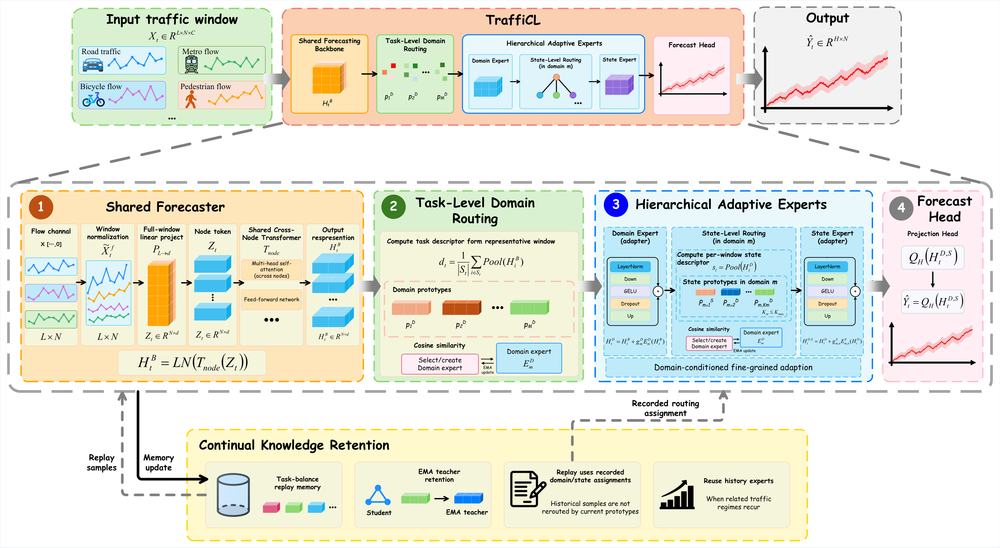

# TraffiCL

PyTorch implementation of TraffiCL for continual traffic forecasting.

<p align="center">
  
</p>

<p align="center">
  <em>The overall framework of TraffiCL.</em>
</p>

## 1. Installation

```bash
cd TraffiCL
python -m pip install -r requirements.txt
```

## 2. Configuration

Configure the model in `configs/models/` and training in `configs/continual/`.
The training script loads the provided TraffiCL configuration by default.

## 3. Training and Evaluation

```bash
python scripts/run_trafficl_global.py \
  --cache-root "/path/to/cache" \
  --seed 42 \
  --datasets caltrans_bicycle caltrans_pedestrian dc_nova pvcgn_hangzhou pvcgn_shanghai shanghai_metroflow minneapolis_i94 mta_subway \
  --output-dir results/trafficl \
  --checkpoint-dir results/trafficl/checkpoints
```

Evaluation runs during training. Results are saved to `results/trafficl/`, and
checkpoints are saved to `results/trafficl/checkpoints/`.

## 4. Resume Training

Append `--resume` to the training command, retaining the original configuration
and checkpoint directory.

## License

This project is released under the MIT License. See [LICENSE](LICENSE) for details.
